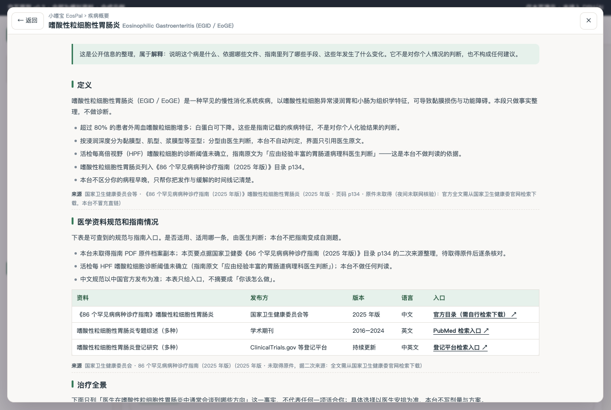
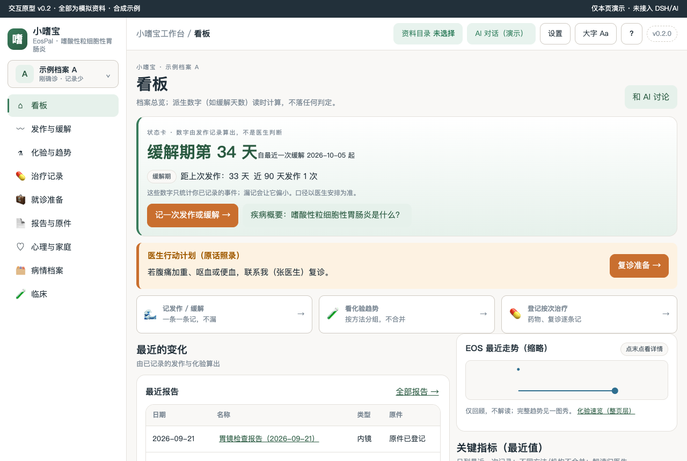
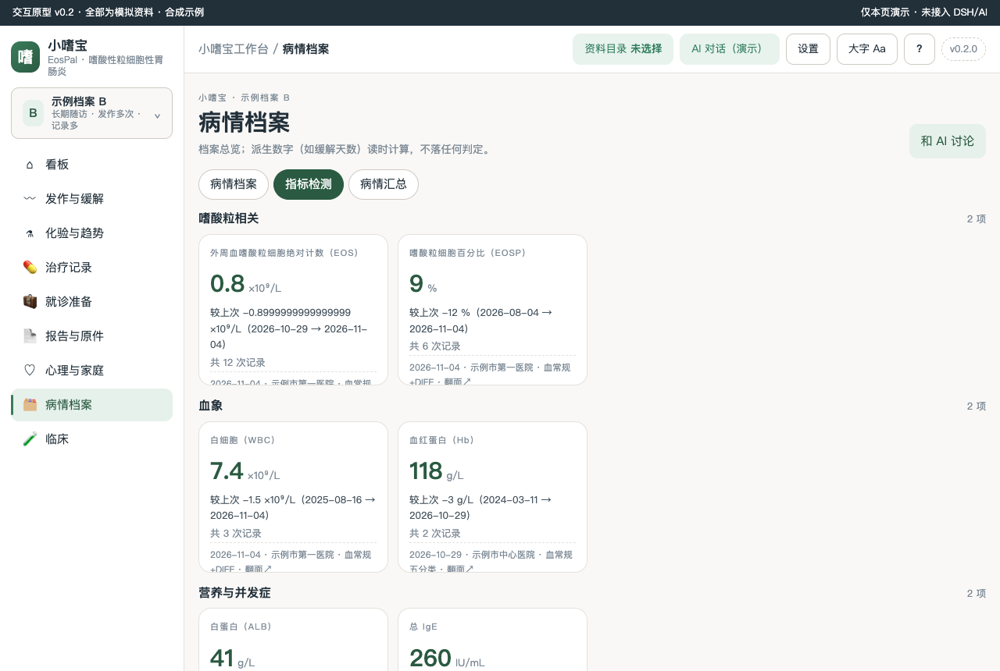
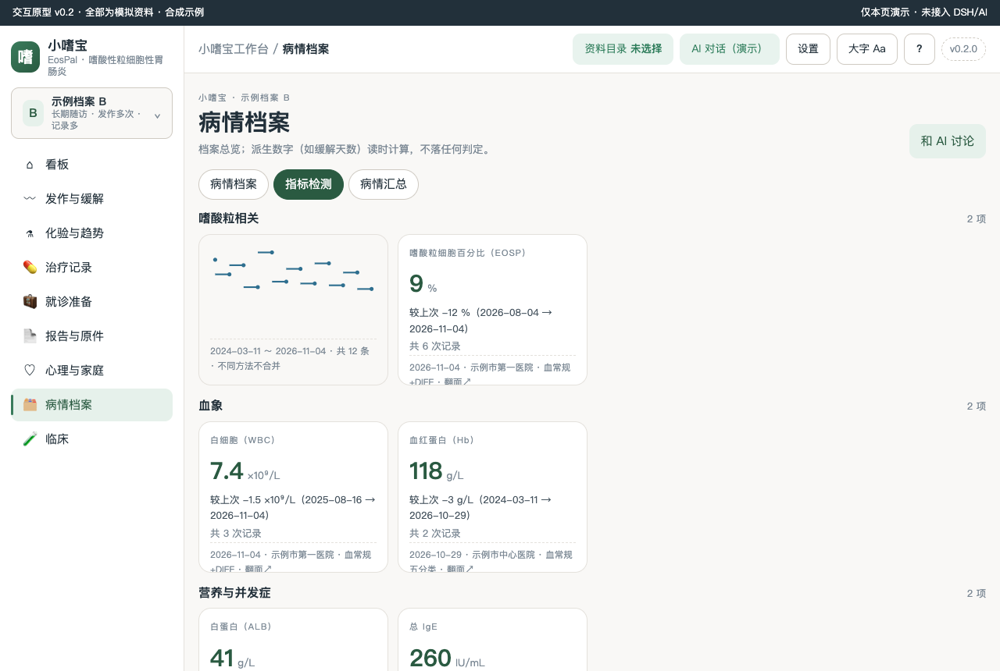
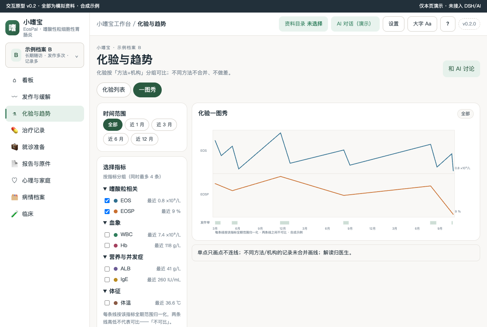
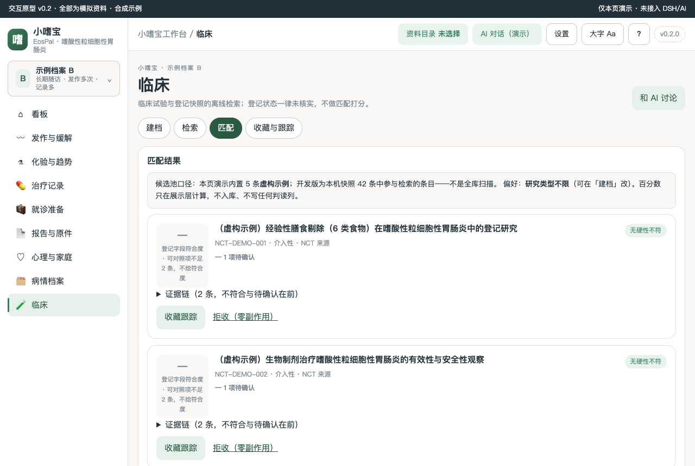
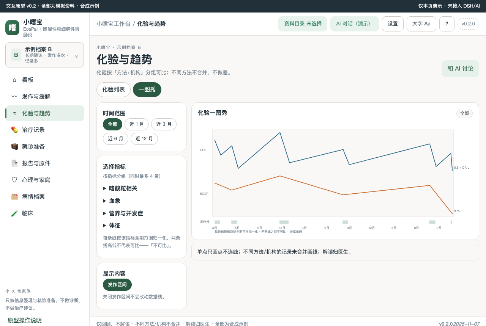
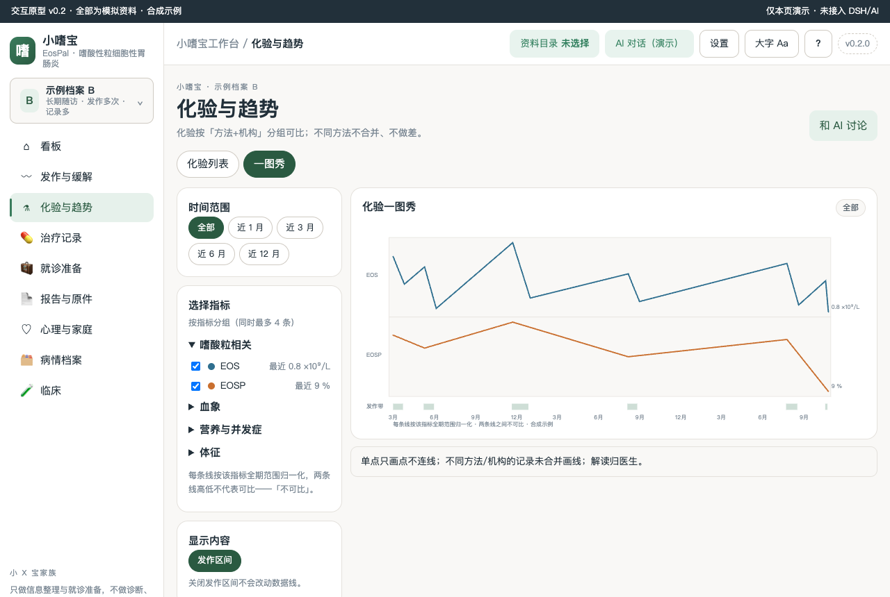

# 小嗜宝 EosPal 嗜酸性粒细胞性胃肠炎工作台 v0.3.0（M5 开发版）

本机优先的嗜酸性粒细胞性胃肠炎（EoGE）发作—缓解记录、嗜酸粒细胞计数趋势、饮食与按次用药登记、内镜随访与复诊准备工作台（合成演示）。

> 状态：M5 开发版 v0.3.0（dsh 服务层 + public 定点移植 + 七套测试；业务数据仍为合成演示，直到导入真实资料）。0 患者访谈、0 临床审核如实标注；所有阈值与参考区间以医生安排为准。

## 疾病概要

顶栏「?」或首页「疾病概要：嗜酸性粒细胞性胃肠炎是什么？」打开整页四段（定义 → 医学资料规范和指南情况 → 治疗全景 → 发展趋势），每段带来源行；内容据国家卫健委《86 个罕见病病种诊疗指南（2025 年版）》目录 p134 二次来源整理（未取得原件档案副本，如实标注），只做解释层，不生成任何判定。

### 定义

嗜酸性粒细胞性胃肠炎（EoGE / EGID）是一类以胃肠道嗜酸性粒细胞异常浸润为特征的炎症性疾病，属《86 个罕见病病种诊疗指南（2025 年版）》目录第 134 条。患者日常最关心的不是「分型分期」，而是**发作与缓解的规律、嗜酸粒细胞（外周血/内镜活检）的趋势、饮食诱因的记录、复诊时能带着清单去**。本台按这个优先级组织，全部内容只做事实整理：仅回顾，不解读；不同方法/机构不合并；解读归医生。

### 医学资料规范和指南情况

国家卫健委《86 个罕见病病种诊疗指南（2025 年版）》目录 p134 收录本病；本台未取得指南原件档案副本，据二次来源整理并如实标注。内镜活检每高倍视野（/HPF）嗜酸粒细胞计数的诊断阈值文献表述不一致、指南未确立统一阈值——本台一律【待核】，判读归病理科医生与主治医生。

### 目前治疗全景概要

本段只做事实整理，不做治疗建议。患者日常接触到的安排通常包括：激素疗程（医生处方）、抗组胺等按次用药、经验性膳食剔除（如 6 类食物剔除）与要素膳等饮食干预——具体方案由医生决定，本台只按次照录登记（治疗记录与饮食记录），不做疗效判定。

### 发展趋势

本台尚未整理（如需补充，据 docs/CLINICAL-DATA.md 与 docs/SOURCES.md 证据台账更新，不写判断性结论）。



## 关键功能（截图墙）

### 1. 看板：现在缓解第几天
首屏大状态卡显示「缓解期第 N 天 / 发作中第 N 天」、距上次发作天数、近 90 天发作次数（私密发作不进聚合并标注「未计入」）；行动带与快捷卡直达常用操作。顶栏可切换示例档案 A/B，整页联动不串档。




### 2. 指标卡（真 3D 翻转）
化验指标按分类成组（嗜酸粒相关/血象/营养与并发症/体征），卡片正面显示最近值/差值/次数/来源，点击翻面看背面趋势缩略；差值只写「较上次」，不做好坏判定。




### 3. 一图秀：长期趋势
左 rail 选时间窗与指标（按分类折叠选择），主图每条序列独立归一化并标注「不同方法不合并」；发作区间带与数据点分层，点末点看原始来源。



### 4. 临床试验（候选线索，非匹配判定）
建档 → 检索 → 匹配 → 收藏四段链路；匹配卡给「登记字段符合度 n/m 项对得上」与逐条证据链，可对照项不足不给百分数；入排标准请到官方登记页核对。



### 5. 折叠收/展态（一图秀指标选择）
原生 details 折叠；打印与键盘语义保留。




## 怎么用

1. 双击打开 `prototypes/v0.2/index.html`（或本地起静态服务）。
2. 顶栏切换「示例档案 A/B」（A：刚确诊记录少；B：长期随访发作与指标都多），整页数据、图表、时间线、导出全部跟着换，不串档。
3. 每个可写页页首「＋ 添加记录」；三态保存（保存并继续录入 / 保存并关闭 / 取消）；演示态不持久化，界面有标注。
4. AI 协助为候选/预览演示态（未接入会话）；「和 AI 讨论」按钮只填草稿不自动发送。

## 数据与口径

- 演示数据唯一源：`prototypes/v0.2/demo-data.js`（两套合成档案，全部标注合成示例）。
- 口径：「仅回顾，不解读」「不同方法/机构不合并」「解读归医生」同屏；私密记录三出口（看板摘要/导出/AI 上下文）共用同一过滤。
- 非肿瘤表达：发作—缓解区间带、缓解期第 N 天；无病期/线序/疗效/预后；活检 /HPF 只登记不判读（指南原文：诊断阈值未确立，由病理科医生判断）。

## 开发

- 原型四件套 + primer/trial-match：`prototypes/v0.2/`；探针：`node scripts/probe-egid-m2.mjs`（36 断言）、`node scripts/probe-disease-primer.mjs --url http://127.0.0.1:<port>/prototypes/v0.2/index.html`（10）、`node scripts/probe-page-view.mjs`（13）。
- 检查链：`npm run check`；文档见 `docs/`（SPEC/DEV-REQUIREMENTS/DIFF-MATRIX/PATIENT-FLOW/SCENARIOS/USER-RESEARCH/INTERACTION-DESIGN/CLINICAL-DATA/DEV-PLAN/EVIDENCE-LEDGER/PROTOTYPE-BASELINE）。
- 版本 v0.2.0 与本 README 截图文件名同源；改包必升版。

### 本地验收（家族通用）

```bash
npm install
npm run check
npm run pack:check
npm pack
```

`npm run check` 只保证"能装"（语法 + 装包合同）。`npm run audit` 管"还是不是家族里的一员"，交付/装机前必须 `release:check` 全绿。静态检查不代表已加载；装机验收见 [docs/06-VALIDATION-AND-RELEASE.md](docs/06-VALIDATION-AND-RELEASE.md) 与 [docs/ACCEPTANCE.md](docs/ACCEPTANCE.md)。

初始化来源记录见 `.dsh-wb-starter.json`；CLI 用法见 [docs/CLI-GIT.md](docs/CLI-GIT.md)。
